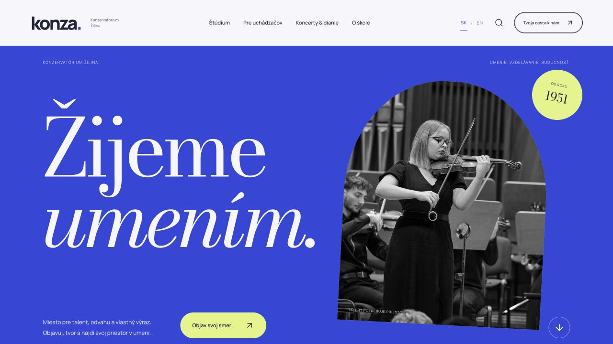

# konza. — Žijeme umením

Nezávislý návrh nového webu **Konzervatória Žilina**. Moderný umelecký dizajn, slovenská a anglická verzia, hudba, spev a kompozícia.

**[Otvoriť webový náhľad](https://matejsmutny1-droid.github.io/konza-redesign/)**



## Čo návrh obsahuje

- 7 hlavných stránok a 90 informačných podstránok v jednom webe.
- Informácie pre uchádzačov a študentov, pedagógovia, vedenie školy, história, školské rady, galérie, koncerty a dokumenty.
- Prepínač SK / EN na všetkých podstránkach, vyhľadávanie, filtre odborov a detail podujatí.
- Responzívne zobrazenie. Pôvodný typografický nápis **konza.** s bodkou.
- Dostupné školské podklady sú súčasťou projektu. Nedostupné dokumenty sú označené.

## Spustenie

Vyžaduje Node.js 22.13 alebo novší.

```sh
npm ci
npm run dev
```

Otvorte adresu z terminálu. Statická produkčná verzia:

```sh
npm run build
npm run preview
```

Výsledok je v `dist/`. Pre nasadenie do podadresára nastavte `VITE_BASE_PATH`, napr. `/konza-redesign/`. GitHub Actions túto hodnotu nastaví automaticky podľa GitHub Pages.

## Úpravy obsahu

- `app/site.tsx`: hlavné stránky, ponuka školy, udalosti, navigácia.
- `app/article.tsx`: zobrazenie informačných podstránok.
- `app/content/pages.json`: obsah podstránok.
- `app/content/translations.json` a `app/translations.ts`: anglické preklady.
- `app/art-direction.css` a `app/globals.css`: dizajn a responzivita.
- `public/`: fotografie, fonty a školské súbory.

Ide o React / TypeScript / Vite aplikáciu, ktorá sa zostaví na statický web. Nevyžaduje ChatGPT prihlásenie, databázu ani server. Priame odkazy na všetkých 97 stránok podporuje exportný skript. Publikovanie zabezpečuje `.github/workflows/pages.yml`; v nastaveniach GitHub Pages je zdrojom **GitHub Actions**.

## Obsah a podklady

Toto je nezávislý dizajnový koncept, nie oficiálna stránka školy. Texty, fotografie a dokumenty vychádzajú zo zverejnených podkladov [konza.sk](https://konza.sk/) k 9. novembru 2026. Školské dokumenty sú v pôvodnej slovenčine. Dostupnosť a aktuálnosť prijímacích podmienok, kontaktov a podujatí je pred oficiálnym spustením potrebné potvrdiť školou.

Práva k školským fotografiám a dokumentom zostávajú ich pôvodným vlastníkom. Repozitár neudeľuje ďalšiu licenciu k týmto podkladom. Závislosti používajú vlastné licencie.
